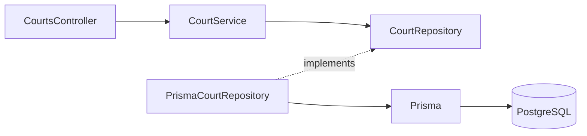
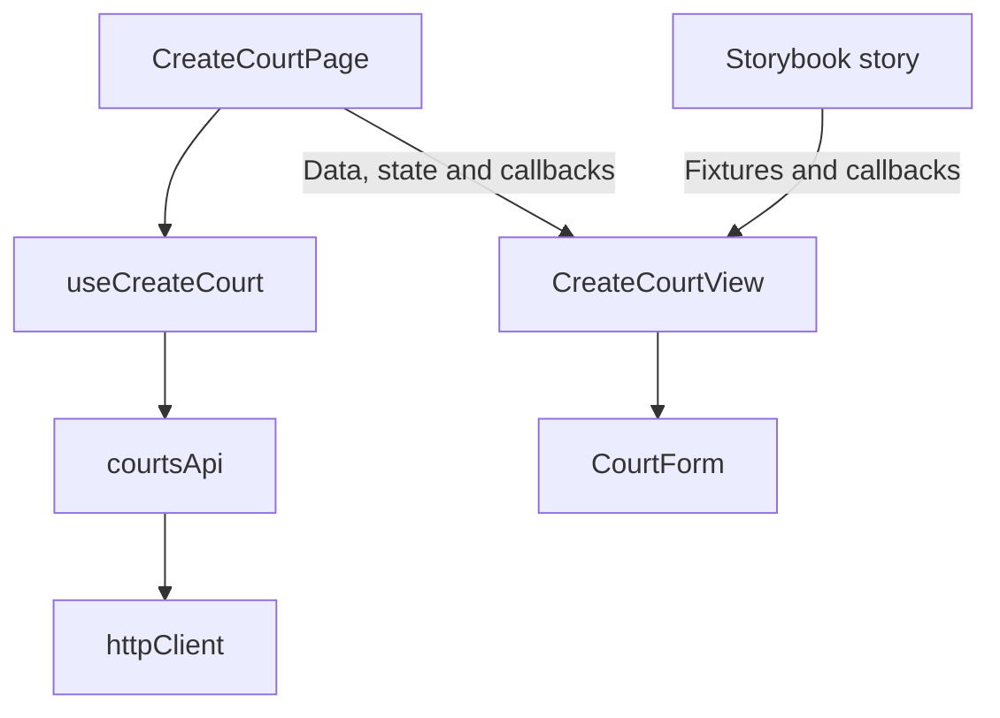

# Courtly architecture

Approved architecture and repository responsibilities. Read with [execution-plan.md](execution-plan.md), [api-contracts.md](api-contracts.md), and [decisions.md](decisions.md). This document defines the architecture; delivery acceptance is tracked through the execution plan and feature PRs.

## Feature boundaries

Organize frontend and backend by feature, such as courts and bookings. Use the layers below in proportion to the challenge; this decision does not require a full Clean Architecture or DDD implementation.

### Backend: layered architecture with Repository Pattern

- Typed tsoa controllers define HTTP contracts and delegate work to services. Generated routes and the authentication boundary enforce input and role requirements.
- Services coordinate business rules and repository operations. Small independent functions can express rules that do not need transport or persistence.
- Feature-specific repositories concentrate database queries and persistence through Prisma. Give them only the operations needed by their feature; do not introduce a generic CRUD repository.
- Presenters prepare the approved response contracts and display fields separately from persistence and business calculations. Do not return Prisma records as API contracts.
- For court creation, the controller delegates to CourtService, which validates the interval and uses CourtRepository to obtain the seeded configuration and persist the active court. CourtService uses presentCourt to prepare the approved representation; the controller returns HTTP 201.
- Repository isolation does not replace real PostgreSQL verification of the booking overlap constraint.



### Repository contracts and Prisma implementations

For each implemented persistence feature, separate its contract from its implementation within the existing feature folder:

- `courtRepository.ts` exports the `CourtRepository` interface and related persistence input types.
- `prismaCourtRepository.ts` exports `PrismaCourtRepository implements CourtRepository` and owns Prisma queries.
- `courtService.ts` consumes `CourtRepository` through its constructor; it does not declare `CourtStore` or another persistence interface.

Apply the same convention to authentication (`AuthRepository` / `PrismaAuthRepository`) and future implemented features such as bookings. Repository interfaces own explicit method signatures with only the operations currently needed; they contain no database calls or dependency on service/transport modules. Existing persisted record types may be reused internally without exposing them as HTTP contracts; this decision does not require a parallel domain-model hierarchy.

Framework adapters reuse the feature contract or a narrow `Pick` rather than declaring a second persistence contract. Services require repository interfaces as constructor arguments; factories require their dependencies explicitly. Do not import or instantiate concrete Prisma repositories in services or authentication logic. This supersedes the earlier permission for default Prisma constructor/factory wiring. Tests provide simple structurally compatible doubles. A named in-memory implementation is optional only when there is a concrete use. Do not add a DI container, composition framework, generic base repository, or unused repositories for every database entity. The seeded Facility remains internal configuration accessed through the existing court repository until another implemented use requires separation.

This formalizes the approved Repository Pattern and replaces the service-local Store naming. It applies to current auth/courts and future implemented persistence features. Public endpoint schemas, business rules, presenters and database migrations remain unchanged by this organization change.

### Manual dependency composition

Use `backend/src/dependencies.ts` as the small composition root for current auth/courts and future implemented features. It constructs the concrete Prisma repositories and injects them into services and the authentication adapter. Controllers call the exported composed services; they do not instantiate services/repositories per request. Keep services stateless so their composed instances can be safely shared across requests.

AuthService and CourtService require repository-interface constructor arguments, with no concrete implementation defaults. The pure authentication factory also receives its repository contract explicitly. The named tsoa expressAuthentication hook delegates to the composed authentication function. Separate the pure factory from the hook when needed to avoid a composition/import cycle; do not have dependencies.ts import a module that imports dependencies.ts back.

For example, the composition root constructs `new AuthService(new PrismaAuthRepository())`; AuthService itself imports only the repository interface. Unit tests instantiate services/factories directly with small doubles. This follows fiapx-api's separation of assembly from execution, using manual composition instead of its tsyringe container. It does not introduce a DI container, registry, service locator, generic factory framework, or new dependencies.

The request flow remains controller -> service -> repository implementation -> database. Composition chooses and connects those objects before requests execute. Preserve HTTP contracts, Prisma queries, authorization, lazy database initialization and error handling. Regenerate tsoa and verify the existing build/tests; confirm application startup and documentation/protected-route smoke behavior without touching application data.

### Model-driven HTTP contracts and Swagger

Request and response models are explicit TypeScript interfaces/types representing public JSON. Controller parameters and declared return types reference those models; tsoa infers their OpenAPI schemas, required/optional fields and structural input validation. Reuse existing service input and presenter output types when their shape matches the API. Keep feature-specific models close to their consumers; extract a small shared feature contract file only when needed. Do not introduce a model registry, generic base DTO, class-decorator framework, or broad file reorganization.

Follow the lightweight typed-controller style demonstrated by fiapx-api: keep route, parameter, authentication, role and success-status decorators. Declare expected non-success responses concisely with the shared ApiErrorResponse type because tsoa cannot infer thrown errors from service bodies. Do not attach manual example payloads to those declarations. Remove descriptive JSDoc and @Example/@example payloads added solely for generated documentation; Swagger UI supplies sample values from schemas. Comments remain exceptional for a genuinely non-obvious implementation reason.

API models remain separate from Prisma models. Preserve the approved JSON fields, display objects, error envelope and runtime rules. Inferring a string or number schema does not implement business validation; keep the current service checks, authorization and error normalization. This change does not adopt fiapx-api's language, DI container, dependencies or other architecture choices.

Detailed business/timezone rules, error codes and curated request/response examples live in api-contracts.md and must be updated in the same PR as behavior changes. Generated Swagger at /api/docs and /api/openapi.json must stay current with schemas, auth, statuses and typed errors; it no longer duplicates all explanatory prose/examples. This explicitly supersedes the previous richer Swagger-metadata requirement. Regenerate in development/build/Docker and never hand-edit generated files. Verify API behavior using direct HTTP requests through curl or small scripts, checking status, payload, authentication and relevant business results. Fetch /api/openapi.json and compare schemas/statuses programmatically; fetch /api/docs to confirm documentation availability. Browser automation and Swagger Try it out are not required for backend acceptance and should be used only when they answer an actual UI/rendering/accessibility question. This lower-cost testing policy supersedes earlier mandatory Swagger UI execution; frontend visual/native accessibility checks remain applicable to frontend deliveries.

### Boundary verification

Framework adapters are included in the repository boundary: expressAuthentication validates/extracts transport credentials and delegates authentication work; it does not query Prisma directly. JWT issuance/verification helpers and shared identity types must be usable without importing that transport adapter into a service. Reuse AuthRepository for current-user lookups as well as login lookups.

Before handoff, inspect changed imports and direct database calls and trace an affected flow through its real consumers. For backend/src, inspect getPrismaClient/PrismaClient/Prisma model calls and classify each occurrence: feature repository or justified connection infrastructure. Schema/migrations/seed and real-database test setup are infrastructure, not examples permitting a controller/service/auth adapter bypass. This is a review check, not a reason for a generic repository, dependency-injection framework, or tests that merely grep source text.

Review evidence must name the committed head, applicable architecture rule, and inspected file/symbol. A working endpoint and passing business tests do not establish this boundary. Report violations under project conventions and resolve them before calling the delivery ready. Mark uninspected criteria explicitly; do not turn an incomplete check into a blanket approval.

### Frontend: Container and Presentational Components

- Integration pages and feature hooks coordinate application operations, loading, normalized errors, and navigation. Feature API modules use the shared HTTP client.
- Presentational views and components receive data, state, and callbacks through typed props. They do not access HTTP, tokens, or routing. Local interface state, such as input values, is allowed without moving business rules into presentation.
- For court creation, CreateCourtPage connects useCreateCourt to CreateCourtView and CourtForm. The page owns routing, the hook coordinates the operation, courtsApi defines the endpoint call, and httpClient handles transport and error normalization.
- Storybook renders the same presentational views using fixtures and callbacks, without requiring API requests. Keep a small set of meaningful stories for pages and reused components, such as initial, submitting, validation-error, and success-dialog states.
- Storybook is development support chosen by the project, not a challenge requirement or a replacement for the mandatory backend tests. Use approved Storybook `10.6.8` and verify its integration during tooling setup.



Storybook reference: https://storybook.js.org/docs/writing-stories/build-pages-with-storybook


## Repository layout — approved

Use a small npm-workspaces monorepo with separate frontend and backend applications:

```text
courtly/
  frontend/
    src/
    .storybook/
    package.json
    Dockerfile
  backend/
    src/
    prisma/
      migrations/
    package.json
    Dockerfile
  docs/
  compose.yaml
  package.json
  package-lock.json
```

The root package is private and declares `frontend` and `backend` as workspaces. It coordinates dependency installation and common build/test commands; it is not a third application. Keep one root package-lock.json. Each workspace owns its application dependencies, scripts, source, and Dockerfile. Keep Prisma schema, migrations, and seed with the backend and Compose at the root. This organization does not require an additional monorepo orchestration tool. Exact runnable scripts are verified during setup rather than treating illustrative command examples as tested implementation.


## Testing strategy — approved

Keep backend unit and integration tests small and focused on the challenge's mandatory rules.

- Unit-test service behavior with a simulated feature repository. Cover opening-hours validation and cancellation timing before, exactly at, and after the inclusive two-hour cutoff. Use a controlled current instant so timing tests are deterministic.
- Integration-test simultaneous booking creation against real PostgreSQL using the versioned application migrations. Two attempts for the same court and interval must leave exactly one persisted booking, with one successful creation and one conflict. Do not replace the database exclusion constraint with a repository mock in this test.
- This delivery will not include automated frontend tests. The challenge makes frontend tests optional; automated testing effort is focused on the mandatory backend rules.
- Use Storybook to demonstrate pages and reused presentational components with fixtures and callbacks, independently of API requests. Show representative initial, loading/submitting, error, empty (where applicable), and success-dialog states rather than creating an extensive story catalog.
- Complement Storybook demonstration with manual verification of primary user/admin flows, keyboard access, visible focus, and native dialog behavior. Record actual verification during implementation; planning these checks does not mean they have already passed.
- Storybook stories alone are not automated tests and do not replace backend unit/integration coverage. Automated frontend and interaction tests are a possible future improvement, outside this delivery.
- Use Vitest `5.1.1` for backend unit and integration tests. Use its mocks and controlled time for deterministic service tests.
- Use an isolated `courtly_test` database on the Docker PostgreSQL instance. Unit tests require no database. Integration tests prepare the test database with the same versioned migrations as the application, including the extension and overlap constraint, and create only their necessary fixture data.
- Provide separate `test:unit` and `test:integration` commands. The integration command prepares the test database and runs the tests. Configure its connection separately from the application database so test setup and cleanup do not affect application data. Exact commands and version-specific migration invocation remain part of tooling validation.
