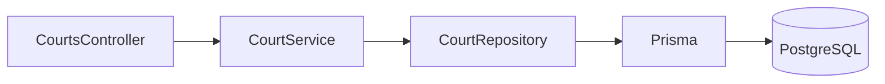
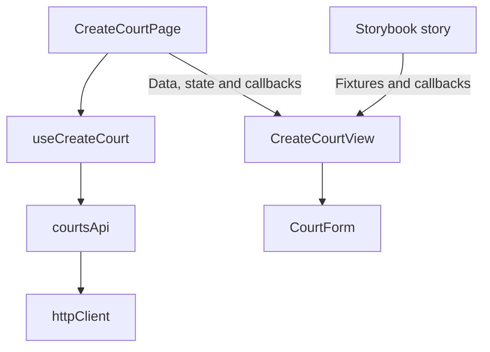

# Courtly planning decisions

This document records approved decisions, not a complete implementation specification. Planning is still in progress. The application has not been implemented.

## Challenge context

Build a small sports court booking application for the Procimo fullstack hiring challenge. The brief permits PostgreSQL, MySQL, or MongoDB and requires TypeScript strict mode, a separate backend, API-enforced roles, database-level double-booking prevention, Docker Compose startup including database initialization and seed, and meaningful backend booking-rule tests.

`docs/challenge.md` contains the local structured restatement of the complete brief and submission constraints. Consult it as the requirements reference and keep project-specific choices separate.

## Approved decisions

- Backend test tooling is approved: Vitest, an isolated `courtly_test` database in Docker PostgreSQL, application migrations for integration setup, and separate `test:unit` and `test:integration` commands. Unit tests need no database; integration fixtures remain small. Versions and exact commands will be fixed during stack-compatibility validation.
- The minimum test strategy is approved: service unit tests with simulated repositories for opening hours and inclusive cancellation timing, plus a real-PostgreSQL concurrent creation test proving one success, one conflict, and one stored booking. Keep test setup small; Storybook supports visual states without requiring an automated frontend suite. See Testing strategy — approved.
- Architecture is approved: feature-oriented layered backend with feature-specific repositories over Prisma, and frontend Container/Presentational Components with typed props and callbacks. Integration pages and hooks coordinate operations; presentation is independently rendered in Storybook with fixtures. See Architecture — approved below.
- The user approved a one-time initial-base exception: create local `main` at existing root commit `c8ce1f8`, containing only the initial project guidance and preliminary planning decisions. This branch now exists; `planning` remains the working branch and retains every later commit for the first PR into `main`. No commits were rewritten or merged. Future changes still require feature branches and PRs, with merge performed only by the user. Remote publication and the first planning PR remain delivery steps.
- Returning from review is simplified: retain court and date in the URL, reload weekly availability, and leave all slots unselected for a new choice. This supersedes automatic restoration of earlier slot choices. Restoring slots, revalidating the full earlier selection, and showing a dedicated stale-selection message are future improvements. Backend rule validation, conflict handling, and database concurrency protection remain in scope.
- The booking preview contract is closed and consolidated in `docs/api-contracts.md`: authenticated `POST /api/bookings/preview` accepts the creation selection and returns court summary, durationHours, and date/start/end/total display labels with HTTP 200. Use creation-equivalent validation and approved errors; persist no draft, booking, hold, or price lock. Reuse internal preparation independently; creation revalidates current data and stores the contracted total under database overlap protection. The live selection-price and review consumers ignore stale preview responses. The approved possible price change before confirmation remains a documented limitation.
- General backend error codes are approved: `INVALID_CREDENTIALS` (401 login failure), `UNAUTHENTICATED` (401 missing/invalid/expired authentication on protected operations), `FORBIDDEN` (403 insufficient permissions), `INVALID_JSON` (400 malformed JSON), and `INTERNAL_ERROR` (500 unexpected failure with a generic message). Use the shared error envelope. Recognized server `INTERNAL_ERROR` remains distinct from frontend fallback `UNKNOWN_ERROR`; authentication navigation and inline credential errors retain their approved behavior.
- Frontend requests use one small HTTP client in infrastructure to attach authentication and normalize failures. Known API errors preserve typed code, message, and optional fields; connection failures remain distinguishable from HTTP responses. Unknown failures and unexpected response bodies become frontend `UNKNOWN_ERROR` with Something went wrong. Please try again. Screens present errors; the authentication flow handles protected-operation 401, with navigation outside the HTTP helper. Domain code does not depend on HTTP or JSON details. This fallback is distinct from the approved backend general error codes.
- Booking and court error codes are approved: `BOOKING_CONFLICT` (409 occupied interval), `COURT_INACTIVE` (409 inactive court at booking creation), `CANCELLATION_WINDOW_CLOSED` (409 new cancellation less than two hours before start), `BOOKING_NOT_FOUND` (404 missing booking), and `COURT_NOT_FOUND` (404 missing court or unavailable court in availability queries). Field errors retain `VALIDATION_ERROR` (422). Client behavior uses code, while message explains the failure; not every 409 means occupied. Preserve exact-two-hour cancellation eligibility and already-cancelled idempotency. General backend codes are approved separately below.
- Authentication wireframes and frontend navigation are approved: `/login` has native email/password inputs and inline invalid-credential errors; successful sign-in establishes the session and opens `/courts` for either role. Protected-operation 401 clears invalid local authentication and opens `/authentication-error`, with Authentication required and an explicit Go to login action, without automatic login redirection or operation retry. Sign out clears local authentication and opens `/login`. Canonical login, invalid-credential, and authentication-error SVG/PNG previews are in `docs/wireframes/`.
- Daily bookings wireframes and navigation are approved: native date input and View bookings, chronological report entries, and backend-formatted expected revenue excluding cancelled bookings. On entry without a date, load the current Facility-local day automatically and initialize the input from the response date, without browser-clock calculations. Explicit date selection remains in the query and URL. This supersedes the required-date API decision. Canonical artifacts: `docs/wireframes/daily-bookings-desktop` and `daily-bookings-mobile` (SVG/PNG).
- Court creation/editing forms and success dialogs are approved. Use native name, free-text sport, dollar-price, and whole-hour time inputs without a visible timezone label; Facility timezone still governs schedule interpretation. Edit uses an Available for bookings checkbox applied only on Save changes, preserving existing bookings and history. Place submit actions below/outside the card. After creation or editing show a native success dialog with Go to courts; navigate only on that button. Escape only dismisses, and completed state prevents repeat submission. Preserve values on failure and show field errors inline. Canonical artifacts are the court-create-* and court-edit-* SVG/PNG files in `docs/wireframes/`.
- The administrator court-list wireframe is approved: reuse the court grid with textual Active/Inactive status, Create court above the grid, Edit court on all items, and View availability only on active courts. Use frontend routes `/courts`, `/courts/new`, and `/courts/{courtId}/edit`; on a direct edit-page load retrieve the existing court collection and find the ID. Administrator navigation adds Daily bookings. Form and deactivation behavior remain a separate block. Canonical artifacts: `docs/wireframes/court-management-desktop` and `court-management-mobile` (SVG/PNG).
- My bookings and cancellation wireframes are approved: a single list in backend-provided descending start order, showing court, date, separate local times, timezone, status, and total. Offer cancellation only with `canCancel: true`; use a native confirmation dialog with Keep booking and Cancel booking. On success update the row and announce success on the same page. For stale cancellation eligibility, show the API explanation and refresh the list without automatic retry. Backend ownership and inclusive two-hour checks remain authoritative. See `docs/ui-flows.md` and `docs/wireframes/my-bookings-*`.
- The court-list wireframe is approved: a three-column desktop grid and single-column mobile layout, showing court name, sport, opening hours, formatted hourly price, and View availability. Open the selected court in the current facility-local week. Add a sport illustration during later visual refinement without introducing an image API field or sport catalog. Canonical artifacts are `docs/wireframes/court-list-desktop` and `court-list-mobile` (SVG/PNG).
- Booking-result dialog layouts are approved: Booking confirmed with Go to my bookings, and Time no longer available with Choose another time. Use native dialog behavior; navigate only on the explicit action. Dismissal never navigates or retries. Preserve completed state after success; after conflict, refresh availability and clear slots only when the recovery action is activated. See `docs/ui-flows.md` and the canonical result-dialog artifacts in `docs/wireframes/`.
- The booking-review wireframe uses option A: a Date and time section with a contextual Change link that retains court and date, reloads availability, and leaves slots unselected. Place Confirm booking outside and below the summary card, right-aligned to its outer edge on desktop and full-width to the card edges on mobile. Keep the Courts / Court 1 / Review breadcrumb; Review is current. The footer-edit alternative is discarded. This approval concerns layout, not final visual styling.
- The weekly-booking selection wireframe layout is closed: desktop left sidebar, compact mobile menu, Courts / Court 1 breadcrumb with only Courts linked to /courts, the existing weekly strip/slot grid, and a high right-side Selected time/price area on desktop (below slots on mobile). Canonical SVG/PNG artifacts and accessibility intentions are documented in `docs/wireframes/README.md`. Do not carry the discarded back/Change court alternatives into implementation. Final visual identity remains open.
- Frontend: React. Backend: Express. Database: PostgreSQL with Prisma. This replaces the earlier MongoDB and Mongoose choice; no application implementation or data migration exists yet.
- Authentication uses JWT bearer tokens with a one-hour lifetime, stored in browser `sessionStorage` so authentication survives page reloads. Login uses seeded email/password credentials; authenticated requests send `Authorization: Bearer <token>`. There is no refresh-token flow or automatic renewal. Registration and password recovery are outside scope.
- `POST /api/auth/login` returns HTTP 200 with `accessToken` and `user: { id, name, role }`; `GET /api/auth/me` validates authentication and returns `{ id, name, role }`. Roles are `user` and `admin`. Store only the token in sessionStorage; retain user data in application state and restore it through `/api/auth/me` after reload, showing a loading state. No stored token means normal login; an invalid/expired stored token leads to the agreed authentication-error page. Do not add `expiresIn` without a client use.
- Exposing role is approved for frontend navigation and visibility, not as proof of authorization. Enforce roles and ownership in the API using validated authentication and trusted server-side data. Never trust client-supplied role or user ID to grant access, and never expose protected data solely on the assumption that the interface hides it. Retain `canCancel` for contextual behavior without introducing a generic permission engine.
- Future authentication improvement: move browser JWT storage to an HttpOnly cookie with appropriate SameSite/Secure settings and CSRF protection. The challenge does not require a particular browser storage strategy or an HttpOnly-cookie implementation. This improvement is outside the current delivery; it addresses the fact that JavaScript-readable token storage is exposed to token theft through XSS. sessionStorage is the approved current trade-off.
- Logout removes the token from sessionStorage and clears local user state. Already-issued JWTs remain valid until expiration, without a revocation system or a backend logout operation in the current bearer-token flow.
- An HTTP 401 from a protected operation leads to a dedicated authentication-error page with an explicit option to navigate to login, not an automatic redirect to the login page. Invalid credentials submitted on the login form remain a login error rather than triggering a navigation loop. The authentication-error page uses `/authentication-error`, Authentication required, and Go to login; its layout is approved in `docs/ui-flows.md`. Other HTTP error behavior remains separate.
- API errors use `{ code, message }`, with optional `fields: [{ field, message }]` only for field-specific validation errors. Messages are ready-to-display English text without a `display` wrapper. Use 400 for malformed JSON, 401 for invalid credentials or missing/invalid/expired tokens, 403 for insufficient permissions or cancelling another user's booking, 404 for missing courts/bookings, 409 for booking overlap/inactive courts blocking new bookings/closed cancellation windows, 422 for invalid fields/past bookings/out-of-hours bookings, and 500 for unexpected failures with generic client messages and technical details only in backend logs. Forms and conflicts stay on the current screen; protected-operation 401 follows the dedicated error-page flow. See `docs/api-contracts.md` for examples.
- Use tsoa with Express. Typed controllers and decorators are the source for generated Express routes, input validation, and OpenAPI. This replaces the proposed Zod plus OpenAPI generation approach. Keep business rules in services and persistence in Prisma; do not expose Prisma models directly as API contracts.
- Run tsoa generation automatically before development startup and production compilation, and regenerate after controller or contract changes during development. Include generation in the Docker build and verification workflow. Treat generated routes and specifications as build artifacts and never edit them manually. Explicitly maintain response and error declarations, authentication metadata, examples, and business-rule descriptions; tsoa cannot infer all runtime behavior. Verify critical response contracts through the existing integration tests without introducing a separate elaborate testing system.
- Use snake_case for database tables and columns and camelCase for TypeScript properties and API JSON fields. Configure the mapping in Prisma so database naming does not propagate into application or domain code. Pin the Prisma version and confirm its mapping and migration APIs during implementation planning.
- All code, interface text, and repository documentation will be in English. Planning conversations may be in Portuguese.
- Implement mandatory requirements only. No optional bonus is planned.
- Whenever the user comments on requirements or scope, consult the relevant section of `docs/challenge.md` before responding or modifying the plan. Identify agreement, incorrect interpretations, and scope additions explicitly instead of accepting them automatically.
- Store each booking as a relational row with start and end instants. Prevent overlapping confirmed bookings for the same court using a PostgreSQL GiST exclusion constraint over `court_id` and `tstzrange(starts_at, ends_at, '[)')`, with the `btree_gist` extension. Half-open intervals allow adjacent bookings. Cancelled bookings remain in history and are excluded from the constraint. Version the extension and constraint SQL through a Prisma-managed migration. Use timestamp-with-time-zone columns for booking instants. The occupied-slot array and MongoDB index approach are superseded.
- Verify double-booking prevention against real PostgreSQL, including concurrent requests, partial overlap, adjacent bookings, and rebooking after cancellation. Translate the specific overlap constraint violation into HTTP 409. Application availability checks alone are insufficient.
- Court changes apply to new bookings. Existing bookings retain their scheduled instants and contracted price, including when a court is deactivated. Deactivation preserves booking history.
- A user may cancel their own confirmed booking when its start instant is at least two hours after the server's current instant, including exactly two hours. Reject a new cancellation when the remaining time is less than two hours. Idempotent retries of an already-cancelled booking do not perform a new cancellation.
- Cancel a booking with `PATCH /api/bookings/{bookingId}` and `{ status: "cancelled" }`, replacing the proposed POST action endpoint. This matches the partial-update convention used for courts. Permit cancellation only, not arbitrary booking edits or reactivation. Enforce authentication and ownership first; an already-cancelled booking returns HTTP 200 with its current representation, unchanged, regardless of its original start time. For a confirmed booking, enforce the cancellation window and return HTTP 200 with the shared cancelled booking representation on success.
- API presentation contracts follow the approved BFF-style approach in `docs/api-contracts.md`, within the existing backend rather than a separate service. Backend-generated `display` objects contain ready-to-render English dates, time ranges, timezone context, status labels, and generic-dollar amounts. IDs and machine-readable status support client actions. Return additional raw fields only when a concrete client operation requires them.
- Field-placement rule: `display` contains derived/formatted/translated strings; identifiers, structured resource data, action inputs, booleans, and machine-readable states stay outside. Original names and free-text sport types remain outside too. Duplicate raw/formatted versions only for distinct current client needs, omit unused fields, and put shared presentation context at the nearest common response level. See the explicit rules in `docs/api-contracts.md`.
- Court opening hours reuse the existing `opensAt` and `closesAt` fields. Do not duplicate these values, add accessible-label fields, or return `display.openingHours`. The frontend composes a spaced visual separator with an accessible `until` equivalent, avoiding duplicate announcements. All slots and booking representations, including personal creation/listing/cancellation and daily reports, expose separate local `display.startsAt` and `display.endsAt` labels instead of combined `display.timeRange` strings. This globally supersedes the earlier combined time-range formatting rule; no additional raw booking timestamps are needed.
- Individual booking representations and the user's booking-list items contain `id`, a court summary, `status`, `canCancel`, and `display`. Omit raw `startsAt`, `endsAt`, and numeric prices from these presentation responses. They remain persisted/calculated on the backend; timezone is obtained from Facility, not duplicated as a Booking column. A single-item representation does not require introducing a booking-detail GET endpoint.
- Availability slots retain machine-readable `startsAt` because booking creation submits `courtId`, `startsAt`, and `durationHours`. A `display` label must never be parsed back into a timestamp or price by the client.
- The request contract for `POST /api/bookings` is approved: `{ courtId, startsAt, durationHours }`, with duration 1 or 2 and authenticated user identity derived on the server. The frontend passes the UTC start returned by availability unchanged. Accept explicit-offset timestamps as absolute instants and reject offset-free timestamps. Never reinterpret the supplied wall-clock time as facility-local time. A two-hour request creates one booking covering consecutive slots.
- Reject booking starts that do not align with a whole-hour slot in the facility timezone, including nonzero local minutes, seconds, or fractional seconds. Return HTTP 422 with the shared `VALIDATION_ERROR` and a `startsAt` field message, `Choose a start time on the hour.` Do not round the value. This check applies independently of how the client obtained the timestamp and does not replace the remaining booking-rule checks.
- The approved `POST /api/bookings` success response is HTTP 201 Created with `{ id, court: { id, name }, status, canCancel, display: { date, startsAt, endsAt, timezone, status, totalPrice } }`. Display start/end values are separate local time strings, not raw timestamps. The new booking is confirmed; compute `canCancel` rather than always returning true, because booking creation with less than two hours of advance notice is allowed. See `docs/api-contracts.md` for the full response example.
- `GET /api/bookings/me` is approved: authenticated, no request body, HTTP 200 with `{ items: [...] }` using the shared booking presentation representation. Include upcoming, past, and cancelled bookings belonging to the authenticated user, ordered by start instant descending. Empty results return `{ items: [] }`. Never accept a client-supplied user ID to select another owner's list.
- Calculate `canCancel` on the server for the requesting user: the booking must belong to that user, be confirmed, and start at least two hours in the future. The UI uses this hint for the action's availability; the API independently revalidates ownership, status, and timing on cancellation because the hint may become stale.
- Model a minimal `Facility` with `id`, `name`, and an IANA `timezone`. Seed one facility and reference it from courts through `facilityId`. Facility CRUD and timezone editing are outside the core scope.
- Facility remains an internal seeded configuration entity. Do not expose facility listing, detail, or management endpoints or build facility selection screens. The earlier `GET /api/facilities` proposal is rejected. Facility timezone drives availability calculations; do not repeat timezone in court responses.
- Facility management is a possible future improvement, including creating, editing, and managing multiple facilities. It is not part of the current delivery and does not change the single seeded facility or require facility endpoints now.
- Court routes are not nested under Facility and do not accept a client-provided `facilityId`; the backend associates new courts with the single seeded facility. `GET /api/courts` lists active courts for users and both active and inactive courts for administrators. `POST /api/courts` and `PATCH /api/courts/{courtId}` are administrator-only. Deactivation uses the same PATCH operation with `isActive: false`, preserving existing bookings.
- `GET /api/courts` is approved with authentication, no request body, and HTTP 200 returning `{ items: [...] }` using the shared court representation. Sort by name ascending without pagination in this delivery. Empty results return `{ items: [] }` with HTTP 200.
- The `POST /api/courts` block is closed: administrator-only creation requires `name`, free-text `sportType`, `hourlyPriceCents`, `opensAt`, and `closesAt`. Name and sport must be nonempty text; price must be a positive integer in cents; times must be whole facility-local hours with opening before closing. The backend assigns the seeded facility and active status. Return HTTP 201 with the approved complete court representation, whose `display` contains only formatted hourly price. Invalid fields return HTTP 422 under the shared error contract.
- `PATCH /api/courts/{courtId}` is approved for administrators, accepting only changed fields from `name`, `sportType`, `hourlyPriceCents`, `opensAt`, `closesAt`, and `isActive`. Omitted fields remain unchanged; reject unknown fields such as `facilityId`. Validate individual supplied fields and related values against the resulting state, including the existing counterpart when only one opening-hour field changes. Return 404 for a missing court, 422 for invalid updates, and 200 with the complete updated court on success. Preserve existing bookings and their contracted prices.
- Each court has one fixed daily opening interval, identical every day, with whole-hour opening and closing times and no overnight interval. These are project simplifications, not additional requirements stated by the brief.
- Opening-hour values such as `08:00` are recurring facility-local times, not instants to convert to UTC at court creation. On each availability query, combine the requested local date and opening interval with the facility timezone to calculate that day's absolute slot instants. Validate incoming booking instants against those local business hours. This on-demand calculation is approved; generated slots are not persisted.
- `sportType` is required free text. Do not introduce a Sport entity, enum, catalog endpoint, or predefined client list in the core. A standardized sport catalog exposed to clients is a possible future improvement, not an implementation task for this delivery.
- Court hourly prices use integer cents in the API, named `hourlyPriceCents`; format these amounts with `$` and two decimal places in the interface.
- Court presentation responses include the structured hourly price and daily opening interval needed by the edit form, with only `hourlyPrice` inside `display`. Remove court-level `display.timezone`; show the single facility's time reference once in shared booking-screen context instead. Reuse the existing opening/closing fields for accessible presentation, without `display.openingHours`. The court and availability examples are in `docs/api-contracts.md`.
- Weekly availability is approved: `GET /api/courts/{courtId}/availability` returns the current Sunday-through-Saturday week in the Facility timezone. An optional `weekStart` requests another week. HTTP 200 contains `courtId`, `weekStart`, `weekEnd`, separate formatted week-boundary labels, backend-generated previous/next API links, and exactly seven chronological days with `date`, `isSelectable`, day/weekday labels, and slots. See the complete example in `docs/api-contracts.md`.
- The weekly query uses optional `weekStart` in exact `YYYY-MM-DD` format. It must be a valid Sunday; otherwise return HTTP 422 through the shared field-validation contract without normalization. Nonexistent and inactive courts both return 404 with `COURT_NOT_FOUND` and `Court not found or unavailable for booking.` Booking history and administrator management remain available. New booking creation against an inactive court remains a separate 409 conflict.
- The weekly availability contract supersedes the earlier daily required-date decision. With no week query, use the current Facility-local week. Do not accept a literal `today`, attach a temporal field to court listings, or require the client to compute week boundaries. Backend navigation links carry fixed Sunday dates; previous is null when the previous week is wholly past.
- Availability retains past slots in API responses with status `past`; the frontend hides slots with that status. Past takes precedence over occupancy: any slot whose start is before the server's current instant is `past`. Remaining slots distinguish `available` and `booked`. No persisted slot records are required: compute status when assembling availability. The server independently rejects past booking creation, regardless of client filtering.
- The approved availability interface has a Sunday-first seven-day strip with backend-prepared day labels and previous/next-week navigation. Show only the selected day's slots without period-of-day groups or slot-length controls. Past dates have `isSelectable: false`; initially choose the first non-past day regardless of free slots. Occupied future slots stay visible, disabled, and labeled `Booked`; past slots are hidden. One or two consecutive hourly slots can be selected. Automatically finding/selecting a day with free slots is deferred as a future improvement. No `currentDate` or `minDate` field is required by this weekly contract.
- The administrator's selected-day booking list across all courts and its total expected revenue are mandatory (`docs/challenge.md`, Administrator day view). This does not imply exports or a separate reporting subsystem.
- The administrator day view uses `GET /api/reports/daily-bookings?date=YYYY-MM-DD`, restricted to administrators by API authorization rather than an `/admin` URL prefix. Interpret the date in the facility timezone. Include confirmed and cancelled bookings across all courts, including deactivated courts, ordered by start instant. Sum contracted totals of confirmed bookings only, including bookings already performed that day; exclude cancelled bookings from expected revenue. Format display values in the backend. The success response is approved in `docs/api-contracts.md`.
- The daily-report request is approved: authenticated administrator GET without a body, with optional `date`. When omitted, default to the current calendar day in the Facility timezone and return that effective date in the existing root `date` field. When supplied, require a valid calendar date in exact `YYYY-MM-DD` format. Return 422 for an empty/invalid supplied date and 403 for an authenticated non-administrator. Read the timezone from the seeded Facility, not a hardcoded report constant or client input. Compute that local day's start and the next local day's start, convert both to UTC, and query booking starts in the half-open interval. Use the same facility timezone for display labels.
- Daily-report booking items must not include `display.status`; retain only machine-readable `status` outside `display`, which the frontend uses for status presentation. This change is specific to the report, not an automatic change to personal booking contracts.
- Omit timezone fields and labels from the daily-report response, including `display.timezone`. Keep reading the facility timezone internally to calculate the selected day's boundaries and format local times. This does not remove the approved shared timezone label from availability responses.
- The daily-report response block is closed and approved: HTTP 200 with `{ date, display: { date, expectedRevenue }, bookings }`. Each booking contains `id`, `court: { id, name }`, `user: { name }`, machine-readable `status`, and `display: { startsAt, endsAt, totalPrice }`. Return bookings chronologically and split local-time labels for accessible presentation. No `canCancel`, raw booking timestamps/prices, report timezone, or `display.status` is needed. An empty day returns `bookings: []` and formatted expected revenue `$0.00`.
- The seeded facility timezone is `America/Sao_Paulo`. Use a generic monetary unit, displayed with the `$` symbol and two decimal places; do not identify it as BRL, USD, or another real currency. Persist monetary amounts as integer cents: `Court.hourlyPriceCents` maps to `hourly_price_cents`, and `Booking.totalPriceCents` maps to `total_price_cents`. At creation, calculate the total from the current hourly price and the one- or two-hour duration and save it with the booking. Price edits and cancellation never recalculate or erase this contracted total. Reports sum confirmed bookings' stored totals; presentation formats them using `$` and two decimal places. Integer cents avoid binary floating-point decimal precision errors for this two-decimal monetary model; an exact decimal type is a valid alternative but unnecessary here. Do not add numeric booking prices to presentation responses that only need formatted totals.
- Store booking start and end instants in UTC. Court opening hours are local times in the facility timezone. The interface displays times in the facility timezone and identifies that timezone explicitly.
- API booking timestamp inputs use ISO 8601 with an explicit offset; raw timestamp outputs where needed use UTC. Availability dates and admin report dates are interpreted in the facility timezone. Booking presentation responses use formatted `display` values instead of raw instants; availability supplies the structured instants needed to create bookings. Cancellation compares instants on the server.
- API documentation must always match the implementation and be available in Swagger UI at `/api/docs`, with the tsoa-generated OpenAPI document at `/api/openapi.json`, when the application starts through Docker Compose. Document every endpoint, authentication and roles, request and response schemas, examples, expected errors, and relevant booking and timezone semantics. API documentation updates belong in the same PR as the behavior change and are part of each delivery's acceptance criteria. Swagger must support exercising the documented operations using the chosen authentication mechanism.
- Preserve incremental, reviewable work through branches and PRs; never commit directly to `main`.
- Branch names describe only the feature or work in lowercase kebab-case, with no AI or agent references or prefixes.
- Commits follow Google-style `<type>: <imperative English summary>` formatting, without a parenthesized scope; for example, `feat: add booking creation`.
- Commit documentation incrementally only when an entire coherent topic block is resolved and the user closes it. Accumulate field-level decisions and adjustments without commits while that block remains open. A complete daily-report response is one block, not one commit per field. This supersedes the earlier per-decision commit cadence; do not rewrite existing commits retroactively without a request. The user authorized reconstructing earlier documentation commits at actual change times from this chat's records; do not invent timestamps or backdate future work without authorization.
- Every commit report must summarize the closed block's decisions and include both the short hash and full commit subject.
- Name the actual approved decision or behavior in each documentation commit subject, rather than using generic descriptions of documentation maintenance. For example: `docs: approve daily booking report response`. The accompanying user-facing message also summarizes the decisions closed and shows the short hash and full subject.
- Commit messages and PR titles and bodies contain no AI attribution, generated-by notices, agent signatures, or agent co-author trailers. The challenge's separate AI-usage disclosure requirement for the submission decisions remains applicable.
- The final execution plan and referenced repository specifications must be sufficient to continue in another chat or agent without this conversation.
- Delivery workflow: the parent agent orchestrates and prepares self-contained implementation tasks; the configured `programador` subagent implements, validates, and opens a feature PR; the configured `revisor` subagent reviews the actual PR diff without modifying code. The orchestrator sends actionable findings back to the developer for correction and subsequent review. The user alone merges PRs. Dependent deliveries start from the merged base.
- The `programador` and `revisor` roles are available with `gpt-6-luna` and high reasoning effort. Use these configured roles rather than substituting models. Follow each role's applicable programming-practices skill. Implementation remains pending specification and incremental-plan completion.
- The candidate writes the README, as required by the challenge. AI may help discuss decisions and review candidate-authored text.

## Architecture — approved

Organize frontend and backend by feature, such as courts and bookings. Use the layers below in proportion to the challenge; this decision does not require a full Clean Architecture or DDD implementation.

### Backend: layered architecture with Repository Pattern

- Typed tsoa controllers define HTTP contracts and delegate work to services. Generated routes and the authentication boundary enforce input and role requirements.
- Services coordinate business rules and repository operations. Small independent functions can express rules that do not need transport or persistence.
- Feature-specific repositories concentrate database queries and persistence through Prisma. Give them only the operations needed by their feature; do not introduce a generic CRUD repository.
- Presenters prepare the approved response contracts and display fields separately from persistence and business calculations. Do not return Prisma records as API contracts.
- For court creation, the controller delegates to CourtService, which validates the interval and uses CourtRepository to obtain the seeded configuration and persist the active court. The controller uses CourtPresenter to return HTTP 201 with the approved representation.
- Repository isolation does not replace real PostgreSQL verification of the booking overlap constraint.

### Frontend: Container and Presentational Components

- Integration pages and feature hooks coordinate application operations, loading, normalized errors, and navigation. Feature API modules use the shared HTTP client.
- Presentational views and components receive data, state, and callbacks through typed props. They do not access HTTP, tokens, or routing. Local interface state, such as input values, is allowed without moving business rules into presentation.
- For court creation, CreateCourtPage connects useCreateCourt to CreateCourtView and CourtForm. The page owns routing, the hook coordinates the operation, courtsApi defines the endpoint call, and httpClient handles transport and error normalization.
- Storybook renders the same presentational views using fixtures and callbacks, without requiring API requests. Keep a small set of meaningful stories for pages and reused components, such as initial, submitting, validation-error, and success-dialog states.
- Storybook is development support chosen by the project, not a challenge requirement or a replacement for the mandatory backend tests. Pin its compatible version during tooling planning.

Storybook reference: https://storybook.js.org/docs/writing-stories/build-pages-with-storybook

## Testing strategy — approved

Keep backend unit and integration tests small and focused on the challenge's mandatory rules.

- Unit-test service behavior with a simulated feature repository. Cover opening-hours validation and cancellation timing before, exactly at, and after the inclusive two-hour cutoff. Use a controlled current instant so timing tests are deterministic.
- Integration-test simultaneous booking creation against real PostgreSQL using the versioned application migrations. Two attempts for the same court and interval must leave exactly one persisted booking, with one successful creation and one conflict. Do not replace the database exclusion constraint with a repository mock in this test.
- Do not require an extensive test suite for every layer. Storybook covers meaningful visual states for pages and reused components; automated frontend tests are not required for this delivery.
- Use Vitest for backend unit and integration tests. Pin the compatible version during stack-compatibility planning. Use its mocks and controlled time for deterministic service tests.
- Use an isolated `courtly_test` database on the Docker PostgreSQL instance. Unit tests require no database. Integration tests prepare the test database with the same versioned migrations as the application, including the extension and overlap constraint, and create only their necessary fixture data.
- Provide separate `test:unit` and `test:integration` commands. The integration command prepares the test database and runs the tests. Configure its connection separately from the application database so test setup and cleanup do not affect application data. Exact commands and version-specific migration invocation remain part of tooling validation.

## Open planning items

- Consolidate remaining endpoint-specific error codes and verify cross-contract consistency before marking the API specification complete. Personal booking request/list/cancellation, separate accessible time labels across all contracts, court creation/listing/editing, availability request/response and inactive-court handling, and the complete daily-report contract are approved; see `docs/api-contracts.md`.
- Finalize remaining API contracts, UI flows, and minimal testing infrastructure. Login, session restoration, role exposure, JWT bearer storage in sessionStorage, and one-hour expiry are approved. Court routes are not facility-scoped. Pin compatible tsoa, Express, and TypeScript versions and confirm generation and development-watch commands.
- Pin compatible PostgreSQL and Prisma versions and validate custom migration and exclusion-constraint error handling before defining implementation tasks.
- Define incremental PR deliverables and acceptance criteria. Local `main` has the approved bootstrap base at `c8ce1f8`; publish this base and `planning` when preparing the first PR. The user reviews and merges that PR.
- Prepare self-contained task briefs for the available `programador` and `revisor` roles, including ownership, specification references, acceptance criteria, dependencies, and verification commands.
- Once planning decisions are closed, consolidate related architectural decisions into concise ADRs with context, alternatives, and consequences to support implementation and the candidate's project defense. Avoid duplicating or contradicting the contracts and challenge reference.

## Technical references

- tsoa setup and generation: https://tsoa-community.github.io/docs/getting-started.html
- tsoa authentication integration: https://tsoa-community.github.io/docs/authentication.html
- tsoa validation error handling: https://tsoa-community.github.io/docs/error-handling.html
- PostgreSQL range exclusion constraints: https://www.postgresql.org/docs/current/rangetypes.html#RANGETYPES-CONSTRAINT
- Prisma database support and version-specific documentation: https://www.prisma.io/docs/orm/supported-databases
- Prisma ORM v7 database mapping: https://www.prisma.io/docs/orm/v7/prisma-schema/data-model/database-mapping
- Prisma ORM v7 extensions through customized migrations: https://www.prisma.io/docs/orm/v7/prisma-schema/postgresql-extensions

Prisma version-specific references illustrate the mechanisms; they do not lock a major version. Confirm the selected version's APIs before implementation.

These references support technical mechanisms; they do not replace the challenge brief or approved product decisions.
